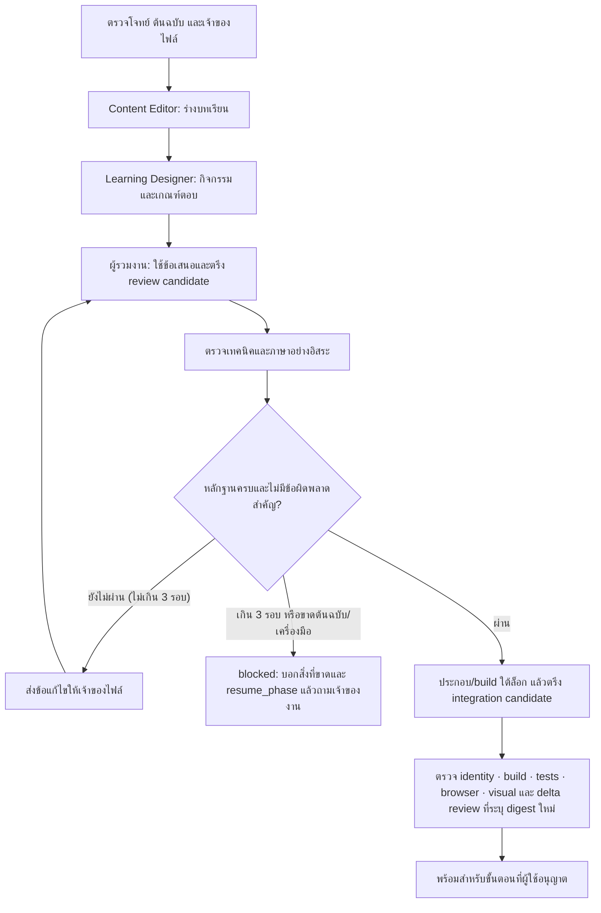

# Atlas: สกิลร่วมกันสำหรับสร้างบทเรียนและตรวจคุณภาพ

สร้างเมื่อ 19 ตุลาคม 2026 (UTC) สำหรับ ROYIN001/atlas-site · ปรับตามผลตรวจอิสระรอบสุดท้าย 20 ตุลาคม 2026

## สกิลและขอบเขต
| สกิล | ผลงานหลัก | ส่งงานต่อให้ |
|---|---|---|
| atlas-content-editor | บทเรียนจากต้นฉบับ ตารางที่มา คำศัพท์ แบบจำลอง และการรวมข้อแก้ไข · เป็นผู้ประสานงานของงานผสม | ผู้ออกแบบกิจกรรม → ผู้ตรวจ |
| atlas-learning-designer | กิจกรรมฝึก คำใบ้ คำถามปากเปล่า และเกณฑ์ตอบ ส่งเป็น learning packet แยก | คืนให้ผู้ประสานงาน (ส่งตรงให้ผู้ตรวจเฉพาะงานออกแบบอย่างเดียว) |
| atlas-technical-reviewer | รายงานตรวจสูตร ภาษา แหล่งอ้างอิง ตัวเลข ตัวตนคำถาม และหลักฐานการทดสอบ | ส่งข้อบกพร่องพร้อมผู้รับผิดชอบกลับไปแก้ |

งานผสมมีผู้ประสานงานคนเดียวคือ atlas-content-editor งานออกแบบกิจกรรมอย่างเดียวและงานตรวจอย่างเดียวใช้สกิลนั้นได้โดยตรงและจบที่ผลงานที่ขอ งานสร้างแบบจำลองอย่างเดียวก็เริ่มที่ atlas-content-editor ซึ่งมอบให้ demo-writer

## ลำดับงานร่วมกัน



- แต่ละไฟล์ต้นฉบับมีเจ้าของคนเดียว ผู้ที่เคยแก้ไฟล์ในรอบใดก็ตามบันทึกใน `contributors` และให้ผลผ่านเป็นผู้ตรวจไม่ได้
- การประกอบไฟล์ การ build และการแก้ไฟล์ส่วนกลางใช้ผู้รวมงานคนเดียวและระบบล็อก STD2 เดิม (`_work/std2-upgrade/STATUS.md`)
- ผู้ตรวจเทคนิคกับผู้ตรวจภาษารับไฟล์เวอร์ชันเดียวกัน และยังไม่อ่านข้อสรุปของอีกฝ่ายก่อนส่งผลรอบแรก
- ผลผ่านทุกชิ้นผูกกับ digest ของ candidate: บรรทัดแรกของรายงานและ log ต้องเป็น `candidate_digest: <ค่า>` (ภาพหน้าจอระบุเองไม่ได้ ให้มีไฟล์ข้อความที่ขึ้นต้นด้วยบรรทัดนี้แล้วลิสต์ภาพกับ sha256) ถ้าไฟล์เปลี่ยนแม้แต่ไบต์เดียว ต้องได้รายงานใหม่ (delta review สั้น ๆ ได้) ห้ามแก้เฉพาะ hash
- ผลตรวจโครงสร้างผ่านไม่ได้รับรองความถูกต้องทางวิชาการ ต้องแยกหลักฐานแต่ละด้าน
- ด่านที่ทำไม่ได้เพราะขาดเครื่องมือหรือต้นฉบับบันทึกเป็น `not_run` แล้วจบที่ `blocked` (พร้อม `resume_phase`) ไม่ใช่ `not_applicable`
- ผู้ที่เขียนหรือแก้ไฟล์ใน candidate ตรวจงานตัวเองได้ แต่ต้องบันทึกผลเป็น `needs_changes` หรือ `blocked` ไม่ใช่ `pass` และห้ามตั้งชื่อผู้ตรวจใหม่ให้ดูเป็นอิสระ — ผลแบบนี้ไม่ทำให้ถึง `reviewed`

## ตัวตนคำถามและประวัติผู้เรียน

- คำถามปากเปล่า (`details.qa`) ที่ไม่มี id ได้ id จากข้อความคำถาม แก้ข้อความแม้แต่คำผิดเดียว id ก็เปลี่ยน และผลซ้อม/รอบทวนของผู้เรียนหลุด ณ 20 ต.ค. 2026 มี 1 565 จาก 2 909 ข้อที่ยังไม่ได้ตรึง id
- บล็อก `quiz2` ที่ไม่มี id ได้ id ตามลำดับ (`<tid>-q<n>`) แทรก ลบ หรือย้ายบล็อกแล้วผลเลื่อนไปผิดบล็อก ถ้าจะตรึงต้องตรึงทุกบล็อกของหัวข้อด้วยแอตทริบิวต์ `id` (ใส่แค่ `data-id` ไม่พอ) และแม้ตรึงแล้ว การ์ดควิซในแถบข้าง (`atlas-quiz-v1`) ยังผูกกับลำดับเสมอ
- แก้ข้อความรัสเซียของศัพท์เดิมใน `MODULES` ทำให้ termKey เปลี่ยน
- วิธีป้องกัน: ตรึง id เดิมจาก `data/qa` ก่อนแก้ แล้วรัน `compare_identity.py --repo . --base-rev <base_revision> --cand . --candidate-digest <digest> --out <run-dir>/identity.json` หลัง build บันทึกเป็น `identity_baseline.report_artifact_id` และอ้างในด่าน identity (ตัวตรวจ handoff อ่านรายงานนี้: digest, base commit และ ok)
- CI (`check.yml`) รันการเทียบเดียวกันกับ merge base ในทุก PR: ตัวตนต่างกันเป็นคำเตือน · เครื่องมือรันไม่ได้หรือ `data/qa` ยังไม่ได้ build เป็นข้อตก

## สอดคล้องกับ Atlas ปัจจุบัน

ต้นฉบับของหัวข้อส่วนใหญ่ไม่ได้อยู่ที่ `data/t` วิชาใน CLAUDE.md §15 ประกอบจาก `_work/<วิชา>std2/` · nav จาก `_work/navpilot/` (§2) · vhist จาก `_work/vhpilot/` (§8) · hist จากต้นทาง История (§10) แก้ `data/t` ตรง ๆ จะถูกทับเมื่อประกอบครั้งถัดไป ไฟล์ `_work` อยู่ในเครื่องเจ้าของงานเท่านั้น clone ใหม่จึงขาดเอกสารและเครื่องมือ สกิลจะทำร่างและรายงานส่วนที่ทำได้ แล้วจบที่ `blocked` สำหรับส่วนที่รวมเข้าเว็บไม่ได้

กติกาอนุมัติต้นแบบรายวิชาเดิมยังใช้เฉพาะงานยกระดับวิชา และนับการอนุมัติที่บันทึกแล้ว (STATUS.md, CLAUDE.md §15 หรือในบทสนทนา) งานแก้เล็กน้อยหรือการแก้สกิลไม่เพิ่มขั้นอนุมัติใหม่

## วิธีเรียกใช้

| โปรแกรม | สกิลอยู่ที่ | วิธีเรียก |
|---|---|---|
| Claude Code ใน checkout นี้ | `.claude/skills/` (โหลดเอง) | `/atlas-content-editor …` หรือพิมพ์คำขอแล้วให้ระบบเลือก (การเลือกเองจากคำขอจริงยังไม่ได้ทดสอบ) |
| Codex ใน checkout นี้ | `.agents/skills/` (สำเนาที่สร้างอัตโนมัติ) + `AGENTS.md` | `$atlas-content-editor …` |
| Claude.ai (Customize › Skills) | อัปโหลดเอง ยังไม่ได้ทดสอบ | พิมพ์ «ใช้ atlas-content-editor …» หลังเปิดใช้ |

ตัวอย่าง (Claude Code):

```text
/atlas-content-editor ปรับบทเรียน [วิชา/หัวข้อ] จาก [เอกสาร]
พร้อมประสาน atlas-learning-designer และ atlas-technical-reviewer
ให้ทำจนได้งานที่ตรวจแล้ว พร้อมระบุหลักฐานและส่วนที่ยังติดขัด
```

```text
/atlas-learning-designer ออกแบบการฝึกจากบทเรียน [หัวข้อ]
เน้นให้ลองตอบรัสเซียก่อนเปิดคำช่วยภาษาไทย
แล้วส่ง packet พร้อม rubric ให้ผู้เขียนนำไปใช้
```

```text
/atlas-technical-reviewer ตรวจการเปลี่ยนแปลง [หัวข้อ/commit]
แยกความถูกต้องเนื้อหา ตัวเลข ภาษา ตัวตนคำถาม และหลักฐานการทำงานของเว็บ
```

ถ้าโปรแกรมยังไม่เห็นสกิลใหม่ ให้เปิด session ใหม่ใน checkout นี้ การมีไฟล์ใน repository ไม่ใช่การติดตั้งสกิลเข้าบัญชี

### ถ้าจะใช้บน Claude.ai
- ต้องอัปโหลดครบสามสกิล (และ russian-thai-translate) เพราะสัญญาร่วมอ้างแม่แบบของ content-editor และสคริปต์ของ technical-reviewer
- ต้องเปิดความสามารถรันโค้ด แต่ Claude.ai ไม่มี repository ไม่มี `_work/` และไม่มี subagent แยก จึงทำได้ถึงร่างหรือรายงาน (`reviewed`/`blocked`) และตั้ง `capabilities.independent_reviewers: false` ไม่ถึง `ready`
- `sync_bundle.py` ใช้ได้เฉพาะใน checkout
- Help Center ของ Claude.ai ระบุว่า description ยาวได้ 200 ตัวอักษร ขณะที่เอกสาร Agent Skills ระบุ 1024 ส่วน description ของสามสกิลนี้ยาว 522–668 ตัว ต้องลองอัปโหลดจริงก่อนจึงจะรู้ว่าผ่านหรือไม่

### ส่งงานต่อข้ามเครื่อง
run directory (`_work/atlas-workflow/<run-id>/`) ไม่ไปกับ git ถ้าจะทำต่อบนเครื่องอื่นหรือบนคลาวด์ ให้คัดลอกทั้งโฟลเดอร์ **และไฟล์ candidate ที่อยู่ใต้ `_work/`** (เช่น `_work/<วิชา>std2/src` และ `out`) ไปที่ path เดิม แล้วบันทึกไว้ใน `limitations` ถ้าไม่มีไฟล์เหล่านั้น ตัวตรวจจะรายงานว่าอ่าน candidate ไม่ได้ตั้งแต่ `integrated` → บันทึก `not_run` และอยู่ที่ `learning_ready` หรือ `blocked` · hash ของไฟล์ข้อความเทียบกันได้ทั้ง Windows (CRLF) และ Linux เพราะตัวตรวจแปลง CRLF เป็น LF ก่อน hash ส่วนไฟล์ไบนารี (รูป) hash ตามไบต์จริง · `check_handoff.py --hash <ไฟล์>…` คำนวณให้

## การบำรุงรักษา

ต้นฉบับสกิลอยู่ใน `.claude/skills/atlas-*` แก้ที่นี่ (ห้ามแก้สำเนาใน `.agents/`) แล้วรัน:

```text
python .claude/skills/atlas-content-editor/scripts/sync_bundle.py --write
python .claude/skills/atlas-content-editor/scripts/sync_bundle.py
python -B -m unittest discover -s .claude/skills/atlas-content-editor/scripts -p "test_*.py"
python -B -m unittest discover -s .claude/skills/atlas-learning-designer/scripts -p "test_*.py"
python -B -m unittest discover -s .claude/skills/atlas-technical-reviewer/scripts -p "test_*.py"
```

อ้างอิงร่วม `workflow-contract.md` และ `repo-adapter.md` ต้องเหมือนกันในทั้งสามสกิล เครื่องมือจะตรวจความต่างก่อนสร้างสำเนาสำหรับ Codex ต้องใช้ Python 3.9 ขึ้นไป (CI ทดสอบ 3.10 และ 3.12) และ Node สำหรับการเทียบ termKey

workflow «Atlas skills» บน GitHub Actions รันชุดตรวจทั้งหมดบน Linux (Python 3.10, 3.12) และ Windows (3.12) ตรวจว่าไฟล์สกิลเก็บใน git แบบ LF (ไม่มี CRLF หรือปลายบรรทัดปน) และลอง `compare_identity.py` กับข้อมูลจริงเมื่อสกิลเปลี่ยน ส่วนการเตือนตัวตนผู้เรียนของทุก PR อยู่ใน `check.yml` ทั้งหมดใช้ standard library ไม่เรียกบริการภายนอกและไม่แก้บทเรียน

## ขอบเขตของหลักฐาน

| เครื่องมือ | ตรวจอะไร | ไม่ได้ตรวจ |
|---|---|---|
| `check_handoff.py` | โครงสร้าง manifest, เจ้าของไฟล์และผู้ร่วมแก้, hash (ข้อความ CRLF→LF · ไบนารีตามจริง), digest รวมไฟล์ที่ลบ, บรรทัดแรกของหลักฐานผ่านต้องเป็น digest ปัจจุบัน, หลักฐาน provenance/technical/language ต้องมีอย่างน้อยหนึ่งชิ้นที่ไม่ได้ผลิตโดยผู้เขียน, gate technical/language อ้างรายงานตรวจของตน, gate identity อ่านรายงาน compare_identity, ข้อห้าม N/A, blocker/major ที่ค้างหรือปิดโดยไม่มีหลักฐาน, เตือนไฟล์ที่เปลี่ยนแต่ไม่อยู่ใน candidate (ยกเว้น `_work/`) | ความถูกต้องของเนื้อหา, ตัวตนจริงของผู้ตรวจ, ว่าคำสั่งรันจริง, การล็อก, สิทธิ์เผยแพร่ |
| `compare_identity.py` | id คำถามปากเปล่า หัวข้อ (รวมย้ายวิชาและ tid ซ้ำ) ตำแหน่ง/ความซ้ำ/id ที่ตรึงของ quiz2 termKey และความสดของ `data/qa` เทียบกับ base revision | ความหมายของคำถามที่แก้ · การ์ดแถบข้าง `atlas-quiz-v1` (แจ้งเป็นหมายเหตุ) |
| `check_learning_packet.py` | โครงสร้าง packet, objective↔กิจกรรม, ประเภทที่มาของทุกกิจกรรม, ป้าย «ผู้เรียบเรียง», การตรวจตัวเลข, hash ของ input, id คำถามตามหัวข้อ, id quiz2 ที่คงไว้, id ใหม่ชนกับ `data/qa` (ใช้ `--repo-root`) | ความถูกต้องของคำตอบและ rubric |

อ่านผลทดสอบและข้อจำกัดได้ใน [รายงานตรวจสอบ](atlas-skills-validation-summary.md) และผลทดลองใน [ผลประเมิน](atlas-skills-evaluation.md)
