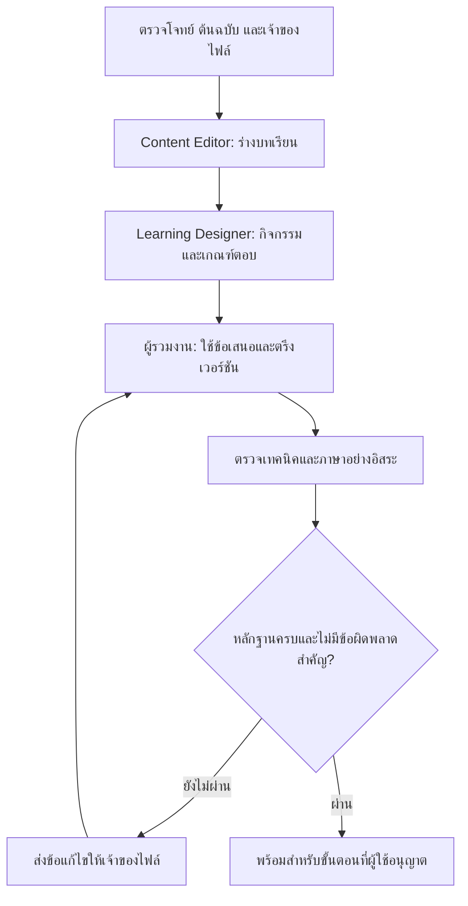

# Atlas: สกิลร่วมกันสำหรับสร้างบทเรียนและตรวจคุณภาพ

สร้างเมื่อ 19 ตุลาคม 2026 (UTC) สำหรับ ROYIN001/atlas-site

## สกิลและขอบเขต
| สกิล | ผลงานหลัก | ผู้ส่งต่องาน |
|---|---|---|
| atlas-content-editor | บทเรียนจากต้นฉบับ ตารางที่มา คำศัพท์ และการรวมข้อแก้ไข | ประสานงานรวมและส่งให้ผู้ออกแบบกิจกรรม/ผู้ตรวจ |
| atlas-learning-designer | กิจกรรมฝึก คำใบ้ การ์ดทบทวน และ rubric สอบปากเปล่า | ส่งชุดข้อเสนอให้ผู้เขียนรวมเข้าบทเรียน |
| atlas-technical-reviewer | รายงานตรวจสูตร ภาษา แหล่งอ้างอิง ตัวเลข และหลักฐานการทดสอบ | ส่งข้อบกพร่องพร้อมผู้รับผิดชอบกลับไปแก้ |

สกิลใช้ร่วมกับ agents เดิมของโปรเจกต์ ไม่มีผู้ประสานงานซ้ำอีกชุด งานออกแบบกิจกรรมอย่างเดียวและงานตรวจอย่างเดียวใช้สกิลนั้นได้โดยตรง

## ลำดับงานร่วมกัน



- แต่ละไฟล์ต้นฉบับมีผู้แก้ไขหลักคนเดียว ผู้ออกแบบกิจกรรมส่ง packet แยก ผู้ตรวจส่งรายงานแยก
- การประกอบไฟล์ การ build และการแก้ไฟล์ส่วนกลางใช้ผู้รวมงานคนเดียวและระบบล็อก STD2 เดิม
- ผู้ตรวจเทคนิคกับผู้ตรวจภาษารับไฟล์เวอร์ชันเดียวกัน และยังไม่อ่านข้อสรุปของอีกฝ่ายก่อนส่งผลรอบแรก
- การแก้สูตร คำตอบ หรือโค้ดทำให้ต้องทบทวนหลักฐานที่เกี่ยวข้อง ผลผ่านของเวอร์ชันเก่าใช้รับรองเวอร์ชันใหม่ไม่ได้
- ผลตรวจโครงสร้างผ่านไม่ได้รับรองความถูกต้องทางวิชาการ ต้องแยกหลักฐานแต่ละด้าน
- คงรหัสคำถามและข้อมูลทบทวนเดิม ศัพท์ที่รับรองแล้วใช้คลังกลางของ russian-thai-translate เพียงแห่งเดียว

## สอดคล้องกับ Atlas ปัจจุบัน

สกิลตรวจว่าแต่ละหัวข้อแก้ที่ data/t โดยตรงได้หรือประกอบจาก _work/<วิชา>std2/src และ demos ถ้าเป็นงานประกอบต้องแก้ต้นฉบับแล้วใช้เครื่องมือเดิม ไฟล์ _work เป็นข้อมูลในเครื่องและไม่อยู่ใน Git การ clone โปรเจกต์จึงอาจยังขาดเอกสารหรือเครื่องมือที่จำเป็น สกิลจะทำร่างและรายงานส่วนที่ทำได้ พร้อมระบุส่วนที่ยังรวมเข้าเว็บไม่ได้อย่างชัดเจน

กติกาอนุมัติต้นแบบรายวิชาเดิมยังใช้เฉพาะงานที่เกี่ยวข้อง และใช้การอนุมัติที่มีแล้วในบทสนทนา งานแก้เล็กน้อยหรือการสร้างสกิลไม่เพิ่มขั้นอนุมัติใหม่

## วิธีเรียกใช้

วิธีเรียกต่างกันตามโปรแกรม: Claude Code ใช้ `/atlas-content-editor` (หรือพิมพ์คำขอแล้วให้ระบบเลือกสกิล) · Codex ใช้ `$atlas-content-editor` · Claude.ai พิมพ์ว่า «ใช้ atlas-content-editor …» หลังเปิดใช้สกิล ตัวอย่างด้านล่างเขียนแบบ Claude Code:

```text
/atlas-content-editor ปรับบทเรียน [วิชา/หัวข้อ] จาก [เอกสาร]
พร้อมประสาน atlas-learning-designer และ atlas-technical-reviewer
ให้ทำจนได้งานที่ตรวจแล้ว พร้อมระบุหลักฐานและส่วนที่ยังติดขัด
```

```text
/atlas-learning-designer ออกแบบการฝึกจากบทเรียน [หัวข้อ]
เน้นให้ลองตอบรัสเซียก่อนเปิดคำช่วยภาษาไทย
แล้วส่ง packet พร้อม rubric ให้ผู้เขียนนำไปใช้
```

```text
/atlas-technical-reviewer ตรวจการเปลี่ยนแปลง [หัวข้อ/commit]
แยกความถูกต้องเนื้อหา ตัวเลข ภาษา และหลักฐานการทำงานของเว็บ
```

Claude Code ใช้ .claude/skills/ ส่วน Codex ใช้ .agents/skills/ ของ checkout นี้ สำเนาทั้งสองตรงกันและมีการตรวจอัตโนมัติ การบันทึกชุดนี้ใน repository ไม่ใช่การติดตั้งสกิลเข้าหน้า Skills ส่วนกลางของบัญชี หากโปรแกรมยังไม่รีเฟรชรายการ ให้เปิด session ใหม่ใน checkout ที่มีไฟล์ชุดนี้

## การบำรุงรักษา

ต้นฉบับสกิลอยู่ใน .claude/skills/atlas-* แก้ที่นี่แล้วรัน:

```text
python .claude/skills/atlas-content-editor/scripts/sync_bundle.py --write
python .claude/skills/atlas-content-editor/scripts/sync_bundle.py
python -B -m unittest discover -s .claude/skills/atlas-technical-reviewer/scripts -p test_check_handoff.py
```

อ้างอิงร่วม workflow-contract.md และ repo-adapter.md ต้องเหมือนกันในทั้งสามสกิล เครื่องมือจะตรวจความต่างก่อนสร้างสำเนาสำหรับ Codex

workflow Atlas skills บน GitHub Actions ตรวจชุดสกิลและการทำงานของตัวตรวจ handoff โดยใช้ Python standard library ไม่เรียกบริการภายนอกหรือแก้บทเรียน

## ขอบเขตของหลักฐาน

ตัวตรวจ handoff ตรวจเจ้าของไฟล์ พาธ ลายพิมพ์ไฟล์ หลักฐานที่ขาด และความสอดคล้องของเวอร์ชัน รวมถึงห้ามสถานะ ready เมื่อยังมี blocker/major ค้าง ตัวตรวจไม่สามารถพิสูจน์ความถูกต้องของเนื้อหา ยืนยันตัวตนผู้ตรวจ หรือทำหน้าที่ล็อกโปรเซสได้ ต้องใช้รายงานและการตรวจจริงร่วมกัน

อ่านผลทดสอบและข้อจำกัดได้ใน [รายงานตรวจสอบ](atlas-skills-validation-summary.md) และดูตัวอย่างผลลัพธ์ใน [หน้าทบทวนผลทดลอง](atlas-skills-evaluation.html) (ดาวน์โหลดแล้วเปิดในเบราว์เซอร์)
